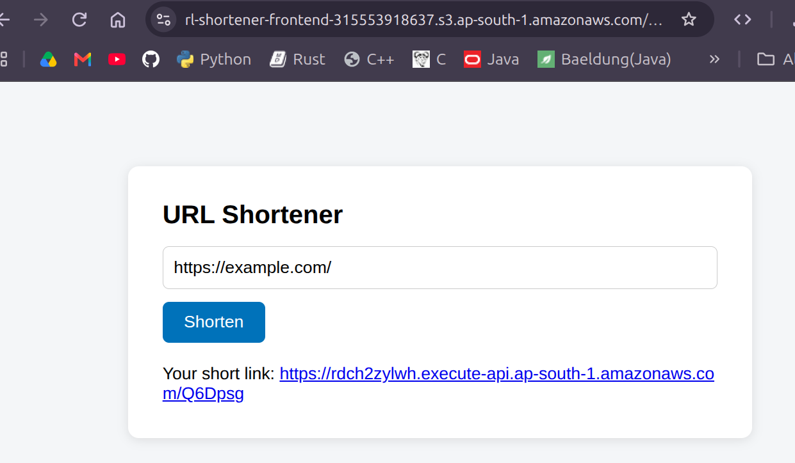
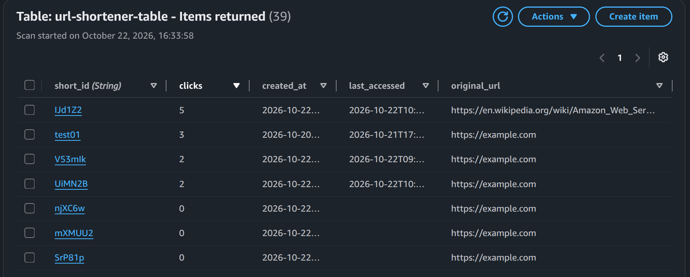

# Serverless URL Shortener

A URL shortener built on AWS serverless services: S3 static frontend, API Gateway HTTP API, three Python Lambda functions and a DynamoDB table. Region: ap-south-1 (Mumbai).

## Features

- Shorten any http/https URL to a 6-character link
- Redirect with click counting
- Statistics endpoint (original URL, clicks, created and last-accessed time)
- Input validation, JSON error responses, least-privilege IAM, API throttling

## Architecture

See [docs/architecture.md](docs/architecture.md).

| Component | Service |
|---|---|
| Frontend | S3 static website (`frontend/`) |
| API | API Gateway HTTP API `url-shortener-api` |
| Backend | Lambda `shorten-url`, `redirect-url`, `get-stats` (`backend/`) |
| Database | DynamoDB `url-shortener-table` (on-demand) |

## API

| Method | Route | Purpose |
|---|---|---|
| POST | `/shorten` | Create a short link |
| GET | `/{short_id}` | Redirect and count a click |
| GET | `/stats/{short_id}` | Get click statistics |

Full details: [docs/api-reference.md](docs/api-reference.md)

```bash
curl -X POST $URL/shorten -H "Content-Type: application/json" -d '{"url":"https://example.com"}'
```

## Screenshots

**Frontend**



**API Gateway routes**


**DynamoDB table**



## Testing

Results of functional, validation and load tests: [docs/test-report.md](docs/test-report.md)

## Repository layout

```
backend/    Lambda source code
frontend/   index.html and app.js
docs/       architecture, API reference, test report, screenshots
infra/      infrastructure notes
```

## Cleanup

All resources were deleted after the demo to avoid charges (API Gateway, S3 bucket, Lambdas, DynamoDB table, log groups).
