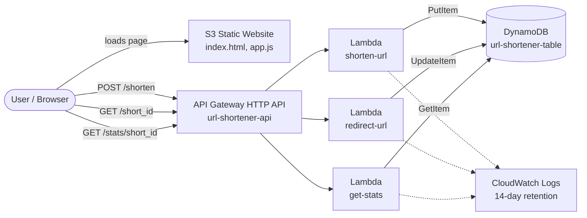

# Architecture

## Request flow

1. The browser loads the page from S3 and calls `POST /shorten`.
2. `shorten-url` validates the URL, creates a 6-character ID and stores it in DynamoDB.
3. Visiting `GET /{short_id}` runs `redirect-url`, which counts the click and returns a 302 redirect.
4. `GET /stats/{short_id}` runs `get-stats`, which returns the URL, click count and timestamps.
